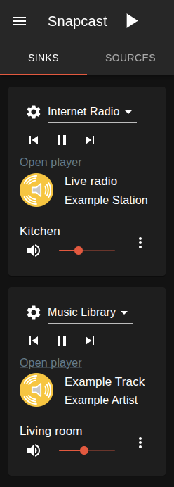
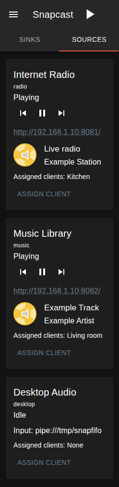

# Snapweb

Web client for [Snapcast](https://github.com/snapcast/snapcast), optimized for
mobile devices, with the look and feel of
[Snapdroid](https://github.com/snapcast/snapdroid)

This fork's Sources preview is version **0.9.4-sources.1**, shown in About
Snapweb. Increment the preview suffix (`sources.2`, `sources.3`, etc.) for
subsequent review builds using `npm version <version> --no-git-tag-version`.
These preview versions are not upstream releases or PR numbers.

## Develop

Use Node.js 24 or newer. Run the client-assignment regression tests with
`npm test` (Node's experimental TypeScript transformation is used).

1. Add your snapserver host as a local environment var
    ```bash
    echo 'VITE_APP_SNAPSERVER_HOST = localhost:1780' > .env.local
    ```
1. Install dependencies
    ```bash
    npm ci
    ```
1. Run local web server and watcher
    ```bash
    npm run dev
    ```

## Build for production

1. Install dependencies: `npm ci`
1. Build: `npm run build`
1. Copy the created `dist` directory to some path on your snapserver host and
   let the `[http] doc_root` in your `snapserver.conf` point to it
1. Restart `snapserver` and navigate with a browser to
   `http://<snapserver host>:1780`
1. Enjoy :)

Prebuilt versions can be downloaded as zip archive or debian package in [Releases](https://github.com/snapcast/snapweb/releases).

## Source player links

The Sources tab lists Snapserver streams and their live title, artist and artwork,
using the same metadata as the Sinks tab. Metadata requires a source that provides
it, for example through a stream control script.

Each source shows its playback status and, when supported, previous, play/pause,
and next controls. Unsupported actions are disabled. The Sinks tab also provides
an "Open player" link for its selected source when a player URL is configured.
Player links open in a new tab; playback controls act directly through Snapserver.

Sources also list their assigned clients, marking muted and (when "Show offline
clients" is enabled) disconnected clients. "Assign client" moves one client to
that source. If it belongs to a multi-client group, the dialog warns before
detaching it; the other clients keep their source. When leaving a muted group,
the moved client stays muted (using its individual mute setting). A failed or interrupted
assignment displays an error. Because detaching and changing the source are
separate server operations, check grouping before retrying a failed assignment.

Radio metadata uses the station name when artist information is missing.

## Configuring sources

Snapserver's configuration is normally `/etc/snapserver.conf` on Linux. For a systemd installation, check `systemctl cat snapserver` and any referenced environment file for custom options.

Configure sources in the existing `[stream]` section, using one `source =`
line per source. The examples below are fragments to adapt to your installation, not complete configuration files:
replace the example addresses, ports and paths, and retain your other settings.

### Source parameters

| Parameter | Meaning |
| --- | --- |
| `name` | Required, stable Snapserver source ID. Keep it unchanged when renaming a source, so existing client assignments continue to refer to it. |
| `display_name` | Optional friendly label shown in the Sources tab and Sinks selectors; defaults to `name`. |
| `player_url` | Optional absolute HTTP(S) URL of the player interface. Sources shows the URL; Sinks shows an "Open player" link. |
| `controlscript` and `controlscriptparams` | Optional Snapserver control script and its arguments, used to provide metadata and supported playback controls. |

`display_name` and `player_url` are conventions of this Snapweb fork, not
built-in Snapcast settings. Snapserver publishes the URI parameters to clients.
They must be URL-encoded: for example, a space becomes `%20`, `:` becomes `%3A`,
`/` becomes `%2F`, and `=` becomes `%3D`. Use `?` before the first parameter
and `&` between parameters. Do not put credentials in the URI: its parameters
are visible to clients that can access Snapserver.

### Example: local audio pipe without a player URL

```ini
[stream]
source = pipe:///tmp/snapfifo?name=default&display_name=Local%20Audio
```

Snapweb displays **Local Audio** and the plain-text input
`pipe:///tmp/snapfifo`. A pipe does not capture desktop audio by itself: an
audio bridge or player must feed it in Snapserver's configured sample format.
See the [Snapcast player setup guide](https://github.com/snapcast/snapcast/blob/v0.27.0/doc/player_setup.md)
for examples.

### Example: MPD and myMPD

The following source uses the ID `player1`, displays **Web Player 1**, links to
myMPD at `http://192.168.1.10:8081/`, and connects the `meta_mpd.py` control
script to MPD on port `6601`:

```ini
[stream]
source = pipe:///tmp/snap-mpd1?name=player1&display_name=Web%20Player%201&controlscript=meta_mpd.py&controlscriptparams=--mpd-port%3D6601&player_url=http%3A%2F%2F192.168.1.10%3A8081%2F
```

MPD, myMPD and the control script must already be installed and configured.
MPD must write audio to the same pipe, with a matching sample format; the
control script must be available to Snapserver. For example, in the relevant
MPD configuration file (often `/etc/mpd.conf`, or a custom file for each MPD
instance):

```conf
audio_output {
    type   "fifo"
    name   "Snapcast"
    path   "/tmp/snap-mpd1"
    format "48000:16:2"
}
```

The example assumes Snapserver's sample format is also `48000:16:2`. See the
[Snapcast source configuration](https://github.com/snapcast/snapcast/blob/v0.27.0/doc/configuration.md#sources)
and [player setup](https://github.com/snapcast/snapcast/blob/v0.27.0/doc/player_setup.md#mpd)
for pipe permissions, audio formats and further setup.

### Example: several independent players

For three preconfigured MPD/myMPD instances, add all of these to the same
existing `[stream]` section:

```ini
source = pipe:///tmp/snap-mpd1?name=player1&display_name=Web%20Player%201&controlscript=meta_mpd.py&controlscriptparams=--mpd-port%3D6601&player_url=http%3A%2F%2F192.168.1.10%3A8081%2F
source = pipe:///tmp/snap-mpd2?name=player2&display_name=Web%20Player%202&controlscript=meta_mpd.py&controlscriptparams=--mpd-port%3D6602&player_url=http%3A%2F%2F192.168.1.10%3A8082%2F
source = pipe:///tmp/snap-mpd3?name=player3&display_name=Web%20Player%203&controlscript=meta_mpd.py&controlscriptparams=--mpd-port%3D6603&player_url=http%3A%2F%2F192.168.1.10%3A8083%2F
```

Each MPD instance needs its own matching pipe and port, and each myMPD instance
must connect to the corresponding MPD. These lines do not create or start the
players. Use addresses reachable by every device running Snapweb; `localhost`
in a player URL refers to the browser's own device, not necessarily the server.

### Apply and verify

After editing the server configuration, restart Snapserver (this briefly
interrupts audio) and check its status:

```sh
sudo systemctl restart snapserver
systemctl status snapserver
```

Refresh Snapweb and open **Sources** to check the names, links and metadata.
No Snapweb rebuild is needed for configuration changes. Restart any audio bridge
that stops when Snapserver restarts. Sources without a player URL show their
pipe address when applicable, otherwise "No player URL configured"; invalid
player URLs display an error rather than a link. `VITE_APP_SOURCE_URLS` is no
longer used.

## Setup as WebApp

On Android open `http://<snapserver host>:1780` in Chrome and select in the menu
`Add to homescreen`

## Screenshots

The Sinks and Sources views in dark mode, shown with example data.

| Sinks | Sources |
| --- | --- |
|  |  |

## Contributing

CI runs the tests, production dependency audit and build. Repository-wide lint
is currently non-blocking because of existing violations; CI reports them as
a warning until they are addressed. A separate CodeQL workflow scans
JavaScript and TypeScript.

Since my time and my web development skills are limited, pull requests are
highly appreciated. Please check the list of
[open issues](https://github.com/snapcast/snapweb/issues).\
Branch from the `develop` branch and ensure it is up to date with the current
`develop` branch before submitting your pull request.

High prio issues:

- Missing opus support [#8](https://github.com/snapcast/snapweb/issues/8)
- Missing Vorbis support [#14](https://github.com/snapcast/snapweb/issues/14)
